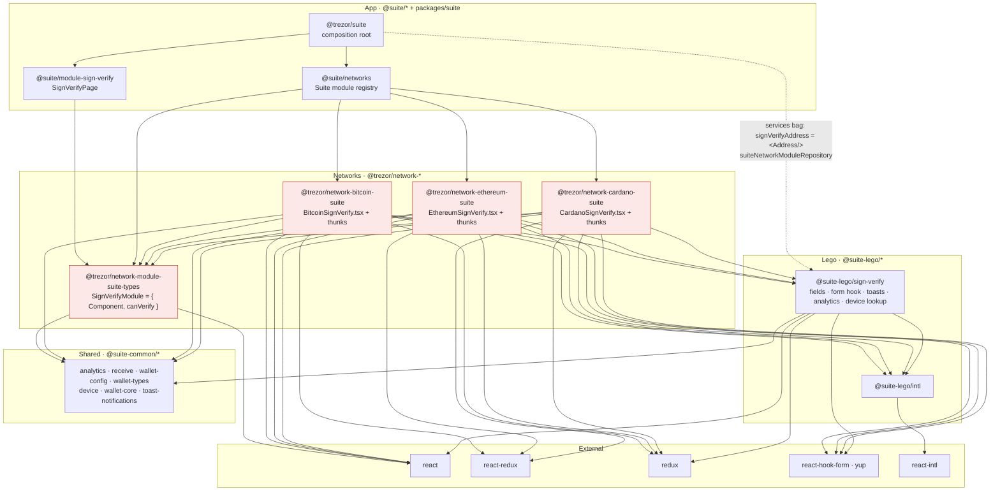
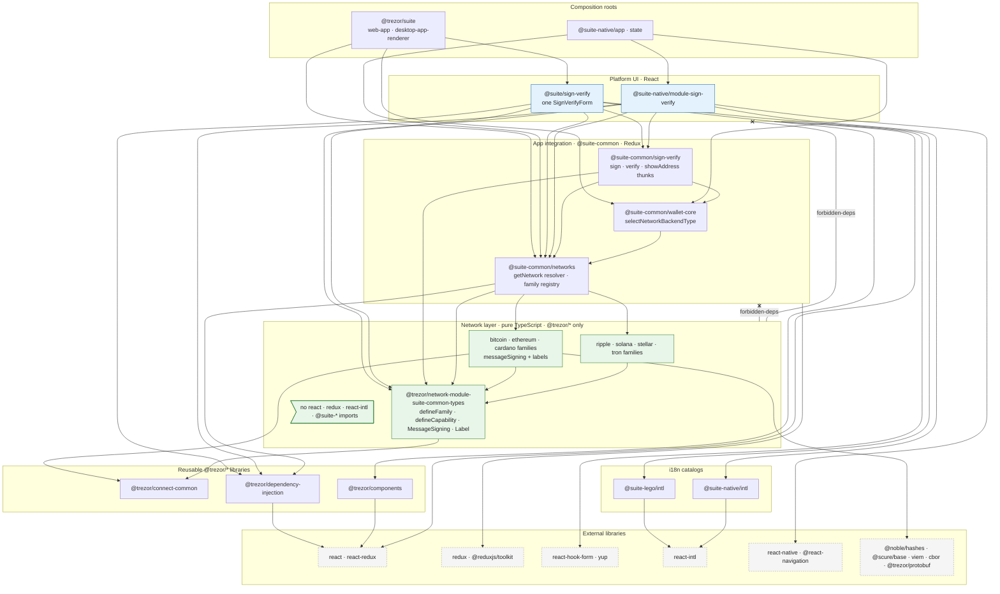
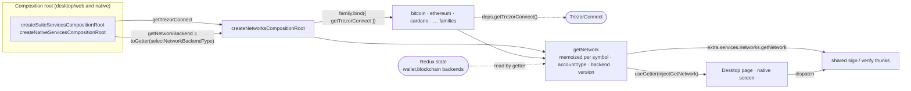
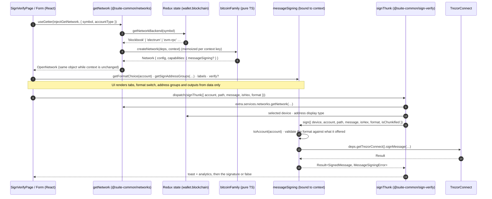

# Networks provide capabilities, applications compose and render them

## Context

Network modularization moves network-specific behavior out of shared code. A new network should be added by registering it, not by editing every feature that branches on the network type. The goals are isolation, loading only what is used, a smaller security surface and simpler development.

[#32473](https://github.com/trezor/trezor-suite/pull/32473) applied the first version of this ADR to sign & verify. Each network got a Suite module that renders its own form, and lego packages hold the shared pieces. That implementation showed where the boundary leaks:

- **Network packages became app code.** `@trezor/network-bitcoin-suite` depends on React, react-redux, redux, react-hook-form, yup, `@suite-lego/intl`, `@suite-lego/sign-verify` and four `@suite-common/*` packages. Its thunks read the store shape and dispatch toasts.
- **The boundary was widened to fit.** The networks rule that forbade `@suite-common/*` was removed.
- **The contract was not independent.** `@trezor/network-module-suite-types` depends on React and on wallet types, because a module exposes a component.
- **UI travelled through the services bag.** The app put a React component, `signVerifyAddress`, into the services so lego could render it.
- **Duplication followed.** One form with a single Cardano branch became three near-identical forms, which would repeat for every feature.

The review of the first version asked to split the dependency rule from the folder layout, for real alternatives, and what happens if the proposal is rejected.

Two more constraints shape the decision. A network is not fixed per symbol. An EVM chain can be served by Blockbook or a custom RPC, and a Solana network can run a version that changes what is possible. Network state, meaning backends and Connect calls, should also stay separate from application state.

## Decision

### Dependency rule

1. **Network packages depend on reusable `@trezor/*` libraries only.** They do not import React, Redux, i18n catalogs or any `@suite/*`, `@suite-common/*`, `@suite-native/*` or `@suite-cli/*` package. `networks/forbiddenDeps.config.ts` enforces this.
2. **Only composition roots name concrete networks.** The desktop, web and native roots register network families and inject what families need, such as Connect. Nothing else imports a concrete family.
3. **App integration owns application state.** Shared thunks in `@suite-common/*` read the selected device and preferences, report analytics, show toasts, and call network capabilities.
4. **Platform UI owns React and translations.** It renders what a capability describes and never branches on the network type.
5. **Each layer receives dependencies through one channel.** Factories take `deps` from the composition root. Thunks read `extra.services`. Components use `useGetter` or `useServices`, plus props.

### Mechanism: network families, context and capabilities

- **A family is a pure TypeScript module**, such as `bitcoinFamily` in `@trezor/network-bitcoin-suite-common`. It turns a network's static config and a runtime context into a network object. The context holds the backend, the account type and the version.
- **A capability is a typed, optional facet of the network**, such as `messageSigning`. It exists only when its declared requirements hold for the context: a feature for the account type, a backend, or a minimum version. Its presence is the support check. There are no parallel boolean flags.
- **Families implement capabilities on their own closed types.** Bitcoin signs with its own account data and offers only `default` or `electrum`. Cardano alone knows its stake address. A boundary, such as `defineMessageSigning`, narrows the app's account and every value passed back on each call. A format the UI hands back must be one the family offered.
- **Labels are data.** A capability carries `{ id, defaultMessage }` labels. Each platform renders them through its own catalog, and a test keeps family labels in step with the desktop catalog.
- **A resolver hands networks to the app.** `getNetwork({ symbol, accountType })` in `@suite-common/networks` resolves through the family serving the symbol, for the backend serving it now. The same context returns the same object, and a backend change resolves a new one.
- **Pages render from capabilities.** The sign & verify page reads its tabs, format switch, address groups and outputs from `messageSigning`, then signs through the shared thunk.

The reference implementation is [#33975](https://github.com/trezor/trezor-suite/pull/33975), stacked on [#32473](https://github.com/trezor/trezor-suite/pull/32473). It applies this to sign & verify on desktop, web and native.

### Diagrams

`A --> B` means A imports B. Dashed edges are runtime wiring by a composition root. `--x` is an import the networks boundary rejects.

Before, as implemented in #32473:

After, boundaries and imports:

After, runtime wiring:

How a page discovers and calls a capability:

### Not decided here

- **Folder and scope renames**, such as `suite-app`, `suite-lego` or `module-*`. With network packages free of UI, the main reason for a lego tier inside `@suite/*` is gone. Any rename that still helps can be its own ADR.
- **Lazy loading of families.** The resolver is the natural place for it; this ADR only keeps that option open.
- **Moving other consumers of `SuiteCommonNetworkModule`** onto families. That happens feature by feature.

### Migration

- **Opportunistic, per feature.** When work touches a feature that branches on the network type, add a capability contract, implement it in the families, and render from it.
- **Parity tests guard each move.** Keep one per migrated feature, until the old feature flag is removed, so the capability cannot drift from it.
- **The existing module repository stays** for config, icons and validation until its consumers move.

## Rejected alternatives

- **Per-network UI modules, as in #32473.** They require network packages to import UI, state and app layers. The boundary has to be widened, the contract depends on React, and every feature is written once per network.
- **A lego tier and a folder rename, as in the first version of this ADR.** This fixes import direction for shared UI pieces, but leaves network packages rendering and reading state. The rename touches the whole codebase and changes what `@suite/*` means twice during the migration.
- **A static per-symbol network registry.** One object per symbol cannot express behavior that depends on the backend, the account type or the version.
- **Enforcing the rule now and renaming later**, Matěj Kříž's option B. This ADR adopts the enforcement half. The rename is left to a later decision.
- **An enforced `module-*` prefix for app feature packages**, Matěj Kříž's option C. This is orthogonal: a naming rule for app packages, compatible with this ADR.
- **Events or streams between networks and the app.** They add indirection and lose typing at the boundary. Direct calls that return `Result` cover the cases so far.

## Consequences

- **Easier:**
    - Adding a network means a new family and one registration line, with no UI change unless the network introduces new vocabulary.
    - Network behavior is tested without React or a store.
    - The boundary is checked by `requirements:verify`.
    - Desktop and native share the same thunks and capabilities, and each feature has one form per platform.
- **Harder:**
    - Each feature needs a capability contract designed up front: its closed and open types, and its labels.
    - Family labels must stay in the platform catalogs, which a test enforces.
    - Developers have to learn `defineFamily` and `defineCapability`.
    - `@suite-common/networks` still hosts the legacy networks Redux slice next to the resolver until it is split out.
- **Ruled out:** network packages that render React, read Redux, or import `@suite-*`.
- **If this is rejected:** the #32473 direction stands. Network packages depend on app layers, the boundary has to be relaxed per feature, and cycles stay possible between shared app code and network packages.
- **Revisit when:**
    - a feature needs network-specific UI that data cannot describe; then consider a UI slot that the app owns and the network fills with data, or
    - lazy loading of families is designed.
