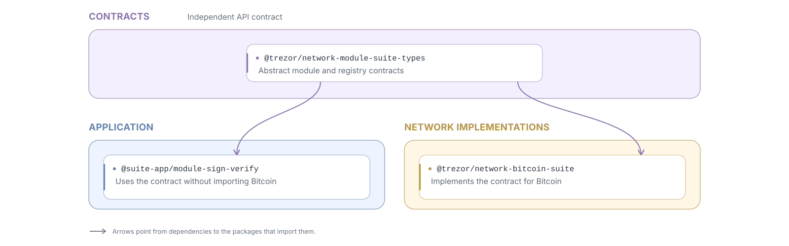
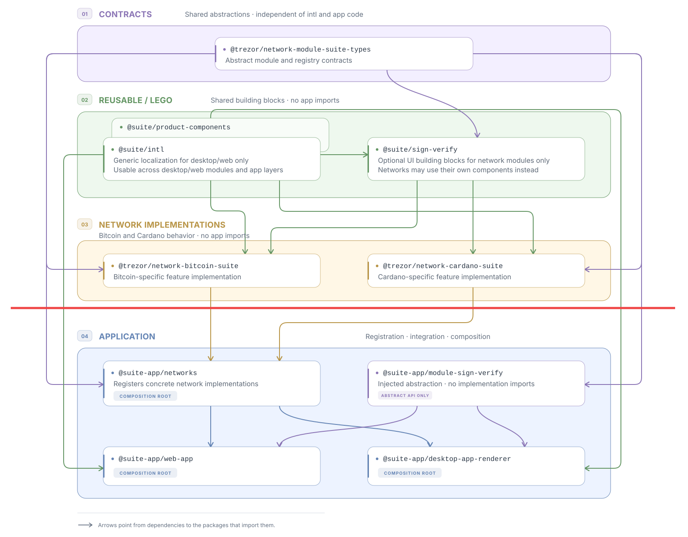

# Separate application composition from reusable building blocks

## Context

Network modules need reusable UI and services from packages such as `@suite/intl` and `@trezor/product-components`.

Importing a useful component from these packages can also pull in application state, routing, or concrete network implementations, creating a risk of tangled code and circular dependencies.

> [!IMPORTANT]
> We need to distinguish code that network modules can import from `@suite/*` from code that assembles those modules into an application.

- [Intl extraction](https://github.com/trezor/trezor-suite/pull/33649): an example of lego extraction.
- [Sign-verify modularization](https://github.com/trezor/trezor-suite/pull/32473): work in progress demonstrating how the split applies to sign-verify.

## Architectural rationale

> [!IMPORTANT]
> **Separation of configuration from use:** components (lego) implement behavior, while app code selects implementations, assembles their dependencies, and wires them into an application.

The wiring belongs in a **Composition Root**, the place near an application's entry point where its dependencies are assembled. This is an application responsibility. In Suite, the web entry point `@suite/web-app` and desktop React entry point `@suite/desktop-app-renderer` already handle parts of this assembly. `@suite/desktop-app` handles Electron packaging and distribution. Registering concrete network modules is another part of that responsibility.

For this proposal, that means the app's business logic is independent of how it is integrated into layouts, menus, and other app-specific structures.

- These components can be composed and tested with explicit dependencies.
- Platform-specific UI also belongs in lego packages when it can be used independently of application assembly.
- The package split makes this dependency direction visible and enforceable with `forbidden-deps`.

### Dependency inversion example

For sign-verify, **dependency inversion** means that the page and the network implementation both depend on an independent API contract. The diagram uses the same final package names as the full example below. Arrows point from a dependency to the code that imports it:



The composition root registers the concrete network modules and injects the module repository into the application. At runtime, `SignVerifyPage` in `@suite-app/sign-verify-page` obtains the selected module's implementation through that repository. Its dependency on network functionality is expressed through the contract: it has no static import or type dependency on `@trezor/network-bitcoin-suite` or another concrete network implementation.

## Decision

Separate code into folders according to its role in application composition:

- **App code** chooses and wires concrete implementations. It owns application navigation, state integration, and assembly of feature pages. **Network modules cannot import app code.**
- **Lego code** provides reusable building blocks that network modules and app code can both import.

### How to distinguish app code from lego code

Think of **wiring versus reusable parts**. App code decides which parts an application uses and connects them: which screens appear in navigation, which network modules are registered, or which storage implementation a service uses. Lego code implements those parts, with explicit dependencies, without deciding how the application is assembled.

Ask: **could another feature, network module, or application use this code by supplying its dependencies, without importing this application's assembly?** If yes, it belongs in lego. If it chooses implementations or connects features for this application, it belongs in app code. Reusable does not mean platform-independent, stateless, or limited to small utilities; a native component or a complete business feature can be a lego.

### Reading the dependency graph

Starting at application entry points, imagine separate trees of application wiring. Where those branches meet at shared dependencies, the tree picture becomes a directed acyclic graph: several consumers import the same reusable parts.

For example, these existing native packages share address UI. Here arrows mean **imports**:

```text
                    @suite-native/app
                      /           \
                     v             v
         module-send                 module-receive       App: screen wiring
                     \             /
                      v           v
                 @suite-native/address                    Lego: address UI
```

This convergence helps identify lego candidates, but the number of importers is not the rule. A lego can have only one consumer today, and app wiring can be shared by several entry points. The deciding factor is whether the code provides a reusable part or assembles a particular application. Dependencies must remain acyclic; lego code must not import app assembly.

### Comparison with Nx apps and libs

Nx's [apps and libs convention](https://nx.dev/docs/kb/folder-structure) is a useful analogy: `apps/mobile` wires an application together, while `libs/address` supplies reusable address UI. Nx also allows [app-specific feature libraries](https://nx.dev/docs/kb/project-dependency-rules), so an Nx `lib` is not automatically lego. Our app layer includes assembly packages such as `module-send`, even though they are imported packages rather than standalone applications. This ADR classifies responsibilities, not Nx project types.

### Examples in Suite

These examples use current package names and describe their intended roles after separation:

| Code                                            | Role | Why                                                                                                                      |
| ----------------------------------------------- | ---- | ------------------------------------------------------------------------------------------------------------------------ |
| `@suite-native/module-*`, such as `module-send` | App  | Assemble screens, navigation, and application behavior from reusable parts.                                              |
| Composition in `@suite-native/suite-sync`       | App  | `createSuiteSyncNativeCompositionRoot` selects native Evolu/SQLite storage and wires it into Suite Sync.                 |
| `@suite/intl`                                   | Lego | Provides translation components and formatting that features and network modules can use without importing app assembly. |
| `@suite-native/address`                         | Lego | Provides address label UI used by multiple features, independently of which screen hosts it.                             |

Existing packages can mix both roles. For example, `@suite-native/suite-sync` also exports UI hooks, and `@suite-native/address` currently imports its `useSuiteSyncErrorHandler`. The migration must separate reusable hooks from Suite Sync composition so address UI can use them without depending on app wiring. Classify the code by its responsibility, then split mixed packages along that boundary.

The diagram and layout below use the final package names after migration. For example, reusable code from `@trezor/product-components` is shown as `@suite/product-components`, and reusable sign-verify UI lives in `@suite/sign-verify`.



## Practical steps

> [!NOTE]
> This is an ongoing, opportunistic migration. We will move and split code when needed for development work, rather than reorganizing it for its own sake.

1. Move app code directly from `@suite/*` to `@suite-app/*` (`suite-app/`), and from `@suite-native/*` to `@suite-native-app/*` (`suite-native-app/`). Apply the same separation to other applications. Reusable code stays in its existing scope.
2. Do this opportunistically as development requires it, splitting mixed packages into app wiring and reusable parts when needed.
3. Once a reusable package is separated from app wiring, allow `@trezor/network-<network>-suite` to import it from `@suite/*`, or `@trezor/network-<network>-suite-native` to import it from `@suite-native/*`. Its dependencies must also be independent of app assembly; each package can become available without waiting for the whole migration.

### Final state example

Illustrative layout after the migration, showing a few packages from each layer:

```text
├── networks/
│   ├── network-module/
│   │   ├── suite-common/
│   │   │   └── suite-common-types/     # Shared contracts
│   │   └── suite/
│   │       └── suite-types/            # Desktop/web contracts (purple in the diagram)
│   ├── bitcoin/                        # Implementation (orange in the diagram)
│   │   └── network-bitcoin-suite/      # Contains sign-verify components for Bitcoin
│   └── cardano/                        # Implementation (orange in the diagram)
│       └── network-cardano-suite/      # Contains sign-verify components for Cardano
├── suite/                              # Desktop/web lego (@suite/*)
│   ├── intl/
│   ├── product-components/
│   └── sign-verify/                    # Optional reusable UI for network modules
│                                       # (when two networks share some UI)
├── suite-app/                          # Desktop/web assembly (@suite-app/*)
│   ├── sign-verify-page/               # Page wiring through module contracts
│   ├── networks/                       # Registers concrete network modules
│   ├── web-app/                        # Composition root
│   ├── desktop-app-renderer/           # Desktop React composition root
│   └── desktop-app/                    # Electron packaging and distribution
├── suite-native/                       # Native lego (@suite-native/*)
│   ├── accounts/
│   └── intl/
└── suite-native-app/                   # Native assembly (@suite-native-app/*)
    ├── module-accounts/
    ├── module-sign-verify/
    └── app/                            # Composition root
```

Network modules can import lego packages for their platform. App assembly imports
and registers concrete network modules; reusable packages do not import app assembly.

## Rejected alternatives

No alternatives were considered in detail, as ideas such as tagging packages or keeping the current structure and relying on developers’ knowledge were rejected immediately for obvious reasons.

## Consequences

1. **❗ Large migration.** We need to move and split code across essentially the whole Suite codebase, separating reusable features and business logic from application assembly.
2. **Clear responsibilities.** Application assembly is clearly separated from feature and business code, allowing reusable functionality to evolve independently of how an app composes it.
3. **Simple dependency rules.** The package split makes it clear what can be imported where. `forbidden-deps` can enforce those boundaries through package scopes and directories.
