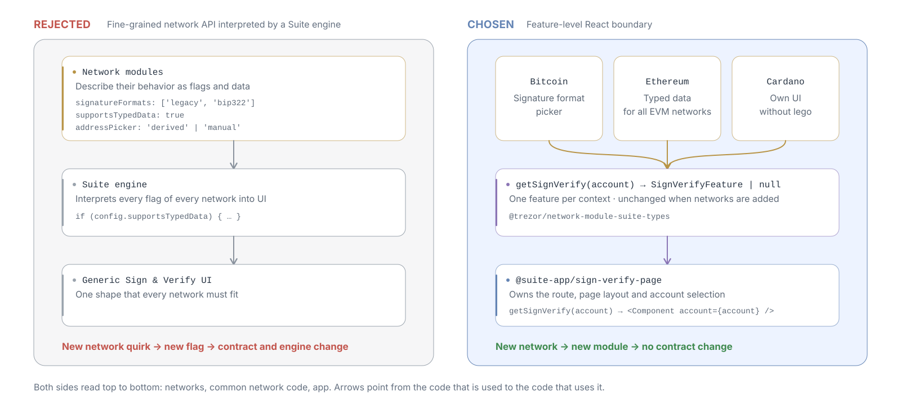
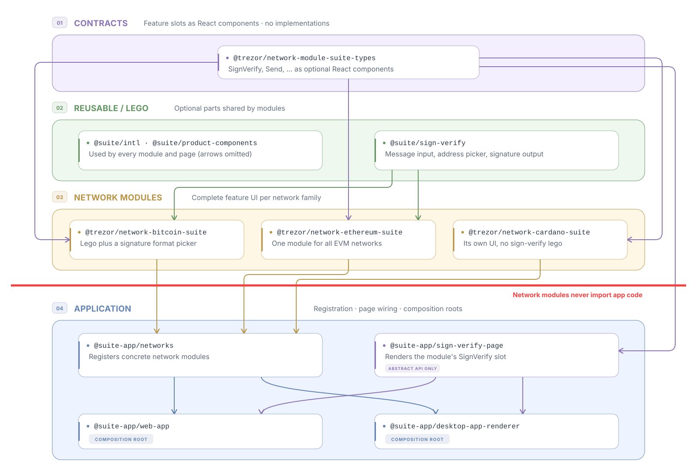

# Network modularization: abstract networks at the feature level

> [!NOTE]
> **Living document.** This ADR documents an ongoing process. It may change as our understanding and
> design of network modularization evolve, also after it is accepted. This is an intentional
> exception to the [ADR process](./README.md), which otherwise leaves an accepted decision
> unchanged: network modularization is too complex to decide in one step.

## Context

Suite supports network families that are vastly different from each other: UTXO-based Bitcoin
with coin control, account-based Ethereum serving many EVM networks with tokens and smart
contracts, Cardano with its own staking and message signing, and Solana, Ripple, Stellar,
Tezos, Tron and Monero, each with its own rules. They differ in account models, fees, signing,
message formats, address types and staking.

Today these differences are handled inside shared features. About 510 `networkType ===` or
`networkType !==` branches in about 270 non-test files of `packages/suite`, `suite`,
`suite-common` and `suite-native` decide what each network does. Adding or changing a network means
editing features owned by other teams.

## Abstraction

The first principles behind this ADR:

1. **Networks are different, and we will not find the right abstraction upfront.** Finding it is
   hard, and the landscape keeps changing.
2. **We modularize per feature, not per network.** We do not look for the common denominator of
   all networks. We model how each Suite feature, such as Sign & Verify, is implemented in those
   networks.

> [!IMPORTANT]
> We therefore abstract networks at the highest level possible.

## Decision

### 1. Abstract at the feature level

The unit of abstraction is a **whole user-facing feature**, such as Sign & Verify, Send or
Receive, not the individual fields, flags or steps inside it. Suite decides **whether** and
**where** a feature appears. The network module decides **what** the feature looks like and how it
behaves.

For example, the whole Sign & Verify form is the abstraction. Bitcoin can offer a signature format
picker, Ethereum can add typed-data signing for all EVM networks, and Cardano can use a completely
different form. None of these differences is visible in the contract or the page.



### 2. React and React Native are the interface

> [!CAUTION]
> This decision is optional, not mandatory. It describes how to modularize a feature when we want
> network modules to provide its components. Functionality that needs no network-specific UI can be
> modularized headless, without React, see
> [Headless contracts are for results, not for UI](#5-headless-contracts-are-for-results-not-for-ui).

The ultimate interface between Suite and a network module is a **React component** on desktop and
web and a **React Native component** on mobile. Components are typed, composable and testable, and
they are already how Suite builds UI. We do not invent a second, Suite-specific language to describe
UI.

Mobile is equivalent to desktop and web, one to one: the same contract shape, the same rules and
the same code structure, with React Native components. The examples below show desktop and web
only.

#### The module returns a feature for a context

**Features are always resolved for a context, never fixed per symbol.** Both the presence and the
shape of the feature code a module returns depend on the parameters passed to the module function.
For example, a module can show a different form for one account type. The feature function returns a
structure that tells Suite whether the feature is supported and carries the feature itself: its
data, or a component when UI is the subject of modularization. It replaces `networkType` branches
that hide features in shared code.

For example, `getSignVerify` returns a `SignVerifyFeature`, or `null` when Sign & Verify is not
supported for the given account.

> [!NOTE]
> Instead of `null`, a module may return a component with its own UI for the unsupported feature.
> It does so when what the user should see for the missing feature is specific to the network.

```ts
// @trezor/network-module-suite-types (illustrative)
export type SignVerifyProps = {
    account: Account;
};

export type SignVerifyFeature = {
    Component: ComponentType<SignVerifyProps>;
    // Optional metadata for the page, such as a header or an icon.
    header?: ReactNode;
};

export type SuiteNetworkModule = {
    getSupportedNetworks: () => readonly NetworkSymbol[];
    getSignVerify: (account: Account) => SignVerifyFeature | null;
    getSend: (account: Account) => SendFeature | null;
};
```

- **Props carry only what Suite owns:** the selected account and similar page context. They do not
  describe network behavior.
- **Each feature is its own small interface**, following the interface segregation principle. A
  page depends only on the feature it renders, and a module implements only the features it
  offers.

> [!NOTE]
> The snippets are illustrative. The concrete API is a technical detail that is not decided here.
>
> The account is only an **example** of what Suite passes to a module. The contract does not
> enumerate what a module may depend on: both the parameters Suite passes and the module's own
> injected configuration, such as the selected backend or the network version, can change which
> features it returns and what they look like. Only the parameters are part of the contract.

#### The page asks for the feature and renders it

Suite resolves the module that serves a context through the network module repository, which maps
symbols to modules. That resolution is hidden behind a service, so pages never look modules up. The
page asks for the feature and renders whatever comes back:

```tsx
// @suite-app/sign-verify-page (illustrative)
export const SignVerifyPage = ({ account }: SignVerifyPageProps) => {
    const { getSignVerify } = useServices(injectGetSignVerify);
    const signVerify = getSignVerify(account);

    if (!signVerify) {
        return <FeatureUnavailable />;
    }

    const { Component, header } = signVerify;

    return (
        <PageLayout header={header}>
            <Component account={account} />
        </PageLayout>
    );
};
```

#### Network details stay inside the module

- **Dependencies such as Trezor Connect are injected when the module is created** in the
  composition root.
- **Backends are an implementation detail of the network.** Which backends a network supports, such
  as Blockbook, Electrum or a custom RPC, which one the user selected, and what each of them can or
  cannot do stay inside the module. The module reads the user's choice through an injected
  dependency, like Trezor Connect, and decides from it which features it returns and how they
  behave. For example, it can hide a signature format picker on a custom RPC backend. Suite never
  passes a backend to a module, and no backend type appears in the contract.

#### Logic and UI are separated inside the module

The component is the boundary between Suite and a module, not the whole module. Inside a module,
business logic stays headless in `@trezor/network-<family>-suite-common` and is shared by desktop
and mobile. The components in `-suite` and `-suite-native` are a thin UI layer over it.

We separate logic from UI by feature inside each module, not by technology across the Suite
boundary.

### 3. Adding a network does not change the abstraction

Adding a network means adding a network module and registering it in `@suite-app/networks`. **It
must not require changes to the contract**, the pages or any shared engine.

> [!IMPORTANT]
> The contract changes only when Suite introduces a new **feature**, which is a product decision, not
> a consequence of a network's quirks.

### 4. Code duplication is solved with lego

Feature-level abstraction can duplicate code between modules. We remove it with lego, shared
building blocks that modules compose, not by lowering the abstraction:

- **Within a family**, one module serves all its networks. For example,
  `@trezor/network-ethereum-suite` implements Sign & Verify for every EVM network.
- **Across families**, modules share parts through lego packages such as `@suite/sign-verify`.
  Extract a lego when a second module needs the same part.
- **Lego is optional.** A module may use some, all or none of it. Cardano can build its own form
  while Bitcoin and Ethereum share a message input and signature output.
- **Lego can be a whole default implementation.** When most families need the same UI for a
  feature, lego can provide a complete default, such as a form shell or the whole form. A family
  opts in with a thin wiring and overrides only what differs. A family that does not fit ignores
  it.

Arrows point from a dependency to the code that imports it:



### 5. Headless contracts are for results, not for UI

An API without React can exist in principle: some features may need only a result from every
network, with no network-specific UI, such as account discovery or portfolio balances. Such an API
belongs to the Suite Common layer, in the platform-independent contract
`@trezor/network-module-suite-common-types`. Which operations it contains is not decided here. It is
still to be explored and defined.

The rule for choosing between the two:

- **The feature looks different per network:** the contract is a component, see
  [React and React Native are the interface](#2-react-and-react-native-are-the-interface).
- **Suite only needs an answer from each network:** the contract can be a high-level headless
  operation that has the same shape for every network.

> [!WARNING]
> If a headless contract starts to describe how a network's UI should look, it has become a
> [Suite engine that interprets a network API](#1-a-fine-grained-network-api-interpreted-by-a-suite-engine),
> which we reject, and the feature should move to a component.

### 6. Each technical layer has its own network module contract

#### What a technical layer is

The same network is needed in very different technical environments: React on desktop and web,
React Native on mobile, Trezor Connect without any UI, and static sites such as connect-explorer
that only need icons and metadata. One contract cannot serve all of them. It would either force
React on Connect, or be too generic to be useful to Suite.

A **technical layer** is one such environment. It is defined by where its code runs and what that
code may depend on, not by the product or application it ships in. Each layer has:

- **its own contract** in `networks/network-module/`, which describes only what that layer needs
  from a network;
- **one implementation package per family**, named `network-<family>-<layer>`, which fulfils that
  contract;
- **its own allowed dependencies**, which its packages must not exceed.

| Layer        | Runs in and may depend on                 | Contract                                    | Family package                  |
| ------------ | ----------------------------------------- | ------------------------------------------- | ------------------------------- |
| Assets       | Static data, no runtime code              | `@trezor/network-assets-types`              | `network-<family>-assets`       |
| Connect      | Trezor Connect, no Suite and no React     | A Connect contract, once modularized        | `network-<family>-connect`      |
| Suite Common | Platform-independent TypeScript, no React | `@trezor/network-module-suite-common-types` | `network-<family>-suite-common` |
| Suite        | React on desktop and web                  | `@trezor/network-module-suite-types`        | `network-<family>-suite`        |
| Suite Native | React Native on mobile                    | `@trezor/network-module-suite-native-types` | `network-<family>-suite-native` |

The package naming and directory rules for the layers are in
[`networks/README.md`](../../networks/README.md).

A consumer uses the contract of the layer that matches its technical needs. The Suite and Suite
Native contracts are described in
[React and React Native are the interface](#2-react-and-react-native-are-the-interface), and the
Suite Common contract in
[Headless contracts are for results, not for UI](#5-headless-contracts-are-for-results-not-for-ui).
connect-explorer already works this way: it consumes per-network packages such as
`@trezor/network-bitcoin-assets` through the Assets contract, without depending on any Suite module.

#### Imports follow the layers

Packages may build on lower layers of the same family, but never on higher ones. Every layer may use
the family's types and assets. Suite and Suite Native build on Suite Common, while Suite Common
stays platform-independent and does not depend on Suite or Suite Native. Two features that sign
messages for the same family use the same signing logic and the same injected backend, even when
they reach it through different contracts.

The same direction applies to lego. A network package may import lego of its own layer and of the
layers below it. A `network-<family>-suite` package may import desktop and web lego from `@suite/*`
and shared lego from `@suite-common/*`, and a `network-<family>-suite-native` package the same with
`@suite-native/*`. A `network-<family>-suite-common` package may import only shared lego.

Code that is not lego, such as services that the app instantiates, is never imported. It reaches the
module through dependency injection.

### 7. Code structure

`networks/` keeps one directory per network family with the technical layers from
[`networks/README.md`](../../networks/README.md). Contracts live in `networks/network-module/`:

```text
networks/
├── network-module/                         # Contracts only, no implementations
│   ├── network-module-types/               # @trezor/network-module-types: NetworkSymbol, config
│   ├── network-assets-types/               # @trezor/network-assets-types: icons and assets
│   ├── suite-common/
│   │   └── suite-common-types/             # Headless, platform-independent contract
│   ├── suite/
│   │   └── suite-types/                    # Desktop/web feature slots (React)
│   └── suite-native/
│       └── suite-native-types/             # Mobile feature slots (React Native)
├── bitcoin/
│   ├── network-bitcoin/                    # Third-party dependencies, runtime utilities
│   ├── network-bitcoin-types/
│   ├── network-bitcoin-assets/
│   ├── network-bitcoin-connect/
│   ├── network-bitcoin-suite-common/       # Platform-independent business logic
│   ├── network-bitcoin-suite/              # Desktop/web features
│   │   └── src/
│   │       ├── signVerify/                 # BitcoinSignVerify and its parts
│   │       ├── send/                       # BitcoinSend and its parts
│   │       └── bitcoinSuiteNetworkModule.ts  # Fills the feature slots
│   └── network-bitcoin-suite-native/       # Mobile features, same layout
├── ethereum/                               # One family for all EVM networks
│   └── …
├── cardano/
│   └── …
└── <family>/
```

Lego, pages and registration live in the rest of the repository:

```text
suite/sign-verify/                          # Optional desktop/web lego for network modules
suite-native/sign-verify/                   # Optional mobile lego for network modules
suite-app/networks/                         # Registers concrete desktop/web network modules
suite-app/sign-verify-page/                 # Renders the SignVerify feature
suite-native-app/module-sign-verify/        # Renders the native SignVerify feature
```

## Practical steps

> [!NOTE]
> This list grows as modularization progresses.

1. Introduce the desktop/web feature contract in `@trezor/network-module-suite-types` with Sign &
   Verify as its first slot.
2. Move the per-network Sign & Verify UI into `@trezor/network-<family>-suite` packages and extract
   shared parts into `@suite/sign-verify`.
3. Repeat for mobile with `@trezor/network-module-suite-native-types`.
4. Continue feature by feature, such as Receive and Send, removing the corresponding `networkType`
   branches from shared code.

## Rejected alternatives

### 1. A fine-grained network API interpreted by a Suite engine

Networks describe themselves with flags, configuration objects or form schemas, and shared pages
render from them. We explicitly reject such a fine-grained network API that a Suite engine
interprets into UI:

- **It grows with every network.** Even when each network keeps its own types, the shared engine
  that renders them must handle the union of all network differences. Each new quirk needs engine
  code, so adding a network changes the abstraction.
- **It rebuilds a UI framework.** The engine becomes an inner platform that reimplements what React
  already does: conditional rendering, composition and layout.
- **It splits network logic.** Understanding Cardano Sign & Verify requires reading Cardano's
  description and the engine that interprets it. A Cardano fix often changes the shared engine,
  which can break every other network.
- **It forces a common shape.** Product and design cannot give a network a different flow without
  extending the engine first.

#### The abstraction can be lowered later but not raised

> [!CAUTION]
> **A wrong, premature abstraction is hell to refactor.** The feature-level abstraction can be
> lowered at any time by replacing a component with a fine-grained API and an engine. The way back
> does not exist in practice: once an engine is built, replacing it with components again is an
> extremely expensive refactoring.

This is the crucial argument of this ADR. The reasons:

- **Lowering is local.** Every network's feature is complete, working and isolated in its own
  module. If the modules of a feature turn out to be alike, we see it in real code and read the
  common shape from it instead of guessing it up front. We can then move that one feature to a
  finer API with a shared implementation. The other features, and the networks that do not fit,
  stay as they are.
- **Raising touches every network.** Each network's behavior is split between its description and
  the shared engine, and the engine's conditions mix the rules of all networks. Taking one network
  out means untangling what the engine does for it from what it does for the others.

We therefore start at the high level, which keeps both options open.

#### Example: a Sign & Verify engine

The following is a simplified engine for Sign & Verify alone. Each network adds fields to the
shared description:

```ts
// Rejected: network description (illustrative)
type SignVerifyConfig = {
    addressSource: 'derived' | 'manual';
    signatureFormats?: readonly ('legacy' | 'bip322')[]; // Bitcoin
    supportsTypedData?: boolean; // Ethereum, EIP-712
    payloadEncodings?: readonly ('text' | 'hex')[]; // Cardano
    signingKeys?: readonly ('payment' | 'stake')[]; // Cardano
    canVerify: boolean; // not every network can verify
    signMessage: (params: SignMessageParams) => Promise<SignMessageResult>;
};

// The union of every network's parameters; each network ignores most of them.
type SignMessageParams = {
    account: Account;
    message: string;
    address?: string;
    format?: 'legacy' | 'bip322';
    typedData?: TypedData;
    encoding?: 'text' | 'hex';
    signingKey?: 'payment' | 'stake';
};
```

The engine interprets every field, including how fields interact:

```tsx
// Rejected: Suite engine (illustrative)
export const GenericSignVerify = ({ account, config }: GenericSignVerifyProps) => {
    const [mode, setMode] = useState<'message' | 'typedData'>('message');
    const [format, setFormat] = useState(config.signatureFormats?.[0]);
    const [encoding, setEncoding] = useState(config.payloadEncodings?.[0] ?? 'text');
    const [signingKey, setSigningKey] = useState(config.signingKeys?.[0]);

    const isTypedData = config.supportsTypedData && mode === 'typedData';
    // Does a signature format apply to typed data? Does hex encoding? Every pair needs a decision.
    const showFormatPicker = !isTypedData && (config.signatureFormats?.length ?? 0) > 1;
    const showEncodingPicker = !isTypedData && (config.payloadEncodings?.length ?? 0) > 1;
    // The stake key has no address picker in Cardano, so this flag changes another one.
    const showAddressPicker = config.addressSource === 'derived' && signingKey !== 'stake';

    return (
        <Form>
            {config.supportsTypedData && <ModeSwitch value={mode} onChange={setMode} />}
            {isTypedData ? <TypedDataEditor /> : <MessageInput encoding={encoding} />}
            {showEncodingPicker && <EncodingPicker value={encoding} onChange={setEncoding} />}
            {config.signingKeys && <SigningKeyPicker value={signingKey} onChange={setSigningKey} />}
            {showAddressPicker ? <DerivedAddressPicker account={account} /> : <AddressInput />}
            {showFormatPicker && <SignatureFormatPicker value={format} onChange={setFormat} />}
            <SignButton /* builds SignMessageParams from all of the above */ />
            {config.canVerify ? <VerifyTab /> : <VerifyUnavailable />}
        </Form>
    );
};
```

Adding Solana off-chain message signing would then mean:

1. A new `offchainMessageFormats` field in `SignVerifyConfig`.
2. A new field in `SignMessageParams`, which every network now receives.
3. A new picker and new visibility rules in the engine, checked against typed data, encodings and
   signing keys.
4. Retesting Bitcoin, Ethereum and Cardano, because the engine they run on has changed.

With the feature-level contract, the same change is a `SolanaSignVerify` component in
`@trezor/network-solana-suite`. The contract, the page and the other networks stay unchanged.

### 2. Keep `networkType` branches in shared features (status quo)

Network knowledge stays spread across features owned by other teams, and every network change
touches them.

### 3. Suite-owned forms with network sub-component slots

Suite owns, for example, the Send form, and networks fill slots such as a fee selector or extra
fields. This still forces one form shape; the slot list grows with every network that does not fit.
Such shared parts are useful as lego that modules choose to use, not as the contract.

### 4. A headless port per feature at the Suite boundary

Every network implements the same headless interface, such as a sign-verify hook, and Suite builds
one UI on top of it. This keeps logic and UI apart, but the port has to be one shared shape for all
networks, and Suite needs a shared UI to interpret it: the rejected
[Suite engine that interprets a network API](#1-a-fine-grained-network-api-interpreted-by-a-suite-engine).
We have seen this pattern before with HTML and CSS: the interface between them, made of class names,
selectors and the DOM structure the styles relied on, became large and fragile, and the industry
moved to styles colocated with components. We keep logic headless inside each module instead; see
[Logic and UI are separated inside the module](#logic-and-ui-are-separated-inside-the-module).

## Consequences

1. **Adding a network is local.** It adds a directory under `networks/` and a registration in the
   app.
2. **Teams can own networks end to end.** A network's features, logic and dependencies live in one
   family directory.
3. **Some duplication remains.** Each family wires each feature once per platform, and modules may
   implement similar UI. Lego, including whole default implementations, keeps this cost small.
4. **Consistency is looser by design.** Shared app logic, such as analytics, reaches modules through
   the dependency injection contract: Suite provides it and every module uses it. UI consistency
   comes from lego and design system components, and the rest is review. Nothing forces a module
   into one shape. This is an intentional trade-off for flexibility: to let a module handle an
   unusual network in a completely different way than lego offers, we must loosen how strictly
   consistency is enforced.
5. **Testing needs no special treatment.** Modules, lego and pages are tested as usual, like any
   other code in the repository.
6. **Revisit if modules converge.** A default implementation in lego covers a feature whose modules
   are alike, see [Code duplication is solved with lego](#4-code-duplication-is-solved-with-lego).
   If that becomes the norm for most features, revisit this ADR.
