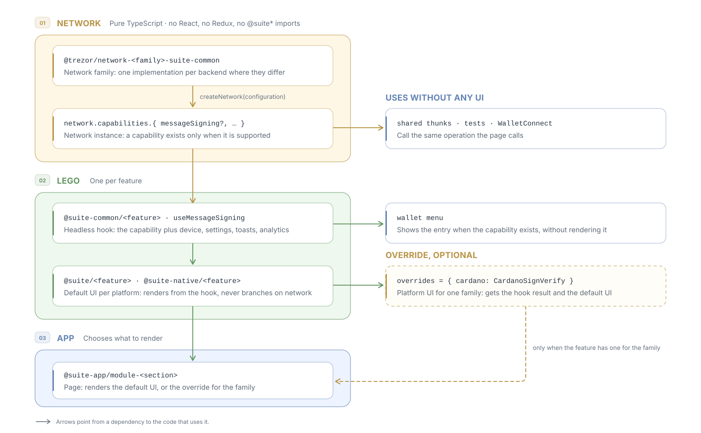

# Network modules expose a headless, typed contract

> [!NOTE]
> Complements ADR-003: per-network UI stays as ADR-003 describes it, and this ADR decides the
> headless contract that ADR-003 leaves open. Narrows [ADR-001](./001-separate-app-and-lego-code.md):
> lego is for a family's UI packages, not its headless package. Reference implementation:
> [`develop...b5f7c559e7`][reference].

## Context

ADR-003 lets a network have its own UI for a feature, keeps a family's logic headless in its
`-suite-common` package, resolves features per account and context, and keeps backends inside the
family. This ADR agrees with all of that. It decides what ADR-003 leaves open: the headless contract.
ADR-003 allows one, but "which operations it contains is not decided".

The callers of that contract already exist, and each of them works around its absence today:

- **Operations outside a screen.** Thunks, WalletConnect and tests sign messages. Trading, staking,
  Earn and RBF compose and sign transactions. A component gives them nothing to call, so each adds
  its own switch over the network, such as `isVerifySupported`, or its own copy of the device
  request.
- **Answers that depend on configuration.** Whether a network follows new blocks, which source
  serves its fees and history, whether Blockaid or ERC-7730 cover it: these depend on the backend,
  remote network metadata or a probe at run time, not only on the symbol. Chains added from a chain
  list over their own RPC are known only at run time. On `develop` such answers are `networkType`
  checks in shared code ([`shouldSubscribeBlocks`][subscribe-blocks]) or values per symbol.
- **Remote data cached by hand.** Fees are refetched on one 60-second timer for every network, from
  a thunk into a slice. Whatever Suite uses to cache remote data, thunks or a query cache, it needs
  a plain operation per network to call, with the network's configuration as part of the key.
- **A record of what a network offers.** Supporting networks at different levels needs a list of
  each network's capabilities per configuration. With a component as the contract, Suite can only
  see whether a feature exists.
- **Logic shares a package graph with screens.** `develop` lets every package under `networks/`
  import `@suite/*`, `@suite-common/*` and `@suite-native/*`
  ([#34986](https://github.com/trezor/trezor-suite/pull/34986)). Testing the code that builds
  device messages and transactions then means mocking the UI and app dependencies it pulls in, and
  a change to a shared component touches every family's diff.

This is not an abstraction guessed ahead of the networks. The logic already exists for every
supported network, in what ADR-003 counts as about 510 `networkType` branches in shared code. The
contract reads the common shape from that code, which is how ADR-003 says an abstraction should be
lowered: "we see it in real code and read the common shape from it instead of guessing it up front".

## Decision

Terms follow the ADR-002 proposal ([#34518](https://github.com/trezor/trezor-suite/pull/34518)): a
**Network** is one blockchain network, a **NetworkFamily** a group of networks sharing a protocol
model. A **network instance** is a Network in one runtime configuration.



1. **A family's headless package is framework-free TypeScript.** `network-<family>-suite-common`,
   with the family's types and assets, MUST NOT import React, React Native, Redux, translation
   catalogs or `@suite*` packages. Anything the app owns is injected.
2. **A family creates a network instance per configuration:** the backend, the account type, the
   version and the network's remote metadata. Pages never pass a backend. How data is fetched,
   following new blocks or polling and how often, is a fact of the instance.
3. **A feature is a typed capability on the instance,** absent when unsupported. Its presence can
   come from the family, from remote metadata or from a probe at run time; a probed capability is
   unknown until the probe answers. Configuration switches capabilities on and off; no code is
   loaded at run time.
4. **Every operation that builds or interprets device messages, transactions or backend data MUST be
   reachable through a capability without rendering UI.** Screens, thunks, WalletConnect, other
   features and tests call the same operation.
5. **What differs between families is the family's own type.** Shared code picks from the options a
   family offers; code that narrows a network to its family passes typed values.
6. **UI never lives in the headless package.** A feature MAY render one shared screen from the
   capabilities, or a screen per family built from lego in the family's UI packages
   (`network-<family>-suite`, `network-<family>-suite-native`, as in ADR-003). Both are
   first-class, and the feature's owners choose.
7. **Shared code MUST NOT branch on network identity.** It branches on capability presence. A
   family's own screen narrows to its family and may use its family's types.
8. **Capability inputs and outputs are plain data,** with no UI elements, class instances or app
   objects, so an instance can be tested without React.
9. **The application supplies the rest:** Trezor Connect, translation, analytics, notifications and
   layout. A headless package never imports a catalog or reports an event.

```ts
// 1. Each family states its own parameters. The shared contract never names them.
type BitcoinSignParams = { format: 'default' | 'electrum' };
type CardanoSignParams = { publicKeyFormat: 'raw' | 'cose' };

// 2. A family's capability is generic over its parameters; the shared contract is not. Shared
//    code sees a parameter as a choice: labels and option ids, never the family's values.
type SignChoice = {
    key: string; // the family's name for it, e.g. Bitcoin's 'format'
    label: Label;
    options: readonly { id: SignChoiceOptionId; label: Label }[]; // ids only the family mints
};
type MessageSigning = {
    getChoices(account: OpenAccount): readonly SignChoice[]; // parameters as labelled options
    sign(params: SignParams & { selection?: SignSelection }): Promise<Result<Signed, SignError>>;
    verify?: (params: VerifyParams) => Promise<Result<void, SignError>>; // absent: cannot verify
};
type FamilyMessageSigning<TParams> = MessageSigning & {
    signWithParams(params: SignParams & TParams): Promise<Result<Signed, SignError>>;
};

// 3. A mapped type over TParams makes the family describe every parameter, with options of
//    that parameter's own type. Leaving one out, or offering Bitcoin a 'cose' value, does not
//    compile.
const bitcoinSigning = defineMessageSigning<BitcoinAccount, BitcoinSignParams>({
    params: {
        format: {
            kind: 'signature',
            getOptions: account => (account.isLegacy ? [trezor] : [trezor, electrum]),
        },
    },
    sign: ({ format, ...params }) =>
        trezorConnect.signMessage({ ...params, no_script_type: format === 'electrum' }),
});

// 4. Shared code (a shared screen, thunks, WalletConnect) gets the open contract for any
//    network.
const signing = getNetwork({ symbol, accountType })?.capabilities.messageSigning;
// Bitcoin offers `format`, Cardano `publicKeyFormat`, Ethereum nothing.
const choices = signing?.getChoices(account) ?? [];
const selection: SignSelection = Object.fromEntries(
    choices.map(choice => [choice.key, pickedByUser(choice)]), // one of choice.options[].id
);
signing?.sign({ ...params, selection }); // a shared screen
signing?.sign(params); // a thunk or WalletConnect: each choice takes its first option
signing?.sign({ ...params, format: 'electrum' }); // ✗ shared code cannot name a family's value

// 5. A family's own screen, in its UI package, narrows the network and gets the family's types
//    back. It calls the same operation as everyone else.
if (bitcoinFamily.isOwnNetwork(network)) {
    network.capabilities.messageSigning?.signWithParams({ ...params, format: 'electrum' }); // ✓
    network.capabilities.messageSigning?.signWithParams({ ...params, format: 'cose' }); // ✗
}
```

Each family keeps precise types for its own parameters, and its own screen gets them back. Shared
code never needs a union of every family's parameters: it only passes back what a family offered.
Adding a parameter, such as a Cardano key role, changes that family and its screen, if it has one.
The names follow the reference implementation, whose type tests check each ✗ above; the exact API
is not part of this decision. There, Sign & Verify went from 41 network checks to 0, the transaction
detail from 28 to 1, and WalletConnect signs through the same capability.

What this ADR leaves open: whether a given feature uses a shared screen or screens per family, which
capabilities exist beyond the ones features need, and how Suite caches remote data.

**Superseded:** in ADR-001, practical step 3 for headless packages: lego stays available to a
family's UI packages. In the ADR-003 proposal, the open headless contract of decision 5 and shared
lego imports into `network-<family>-suite-common`. ADR-003's per-family UI packages stay.

## Rejected alternatives

- **A component as the only contract:** logic that builds device messages and transactions is then
  reachable only through a screen, other callers rebuild it, and each family implements it behind
  both React and React Native.
- **One shared screen per feature, always:** a family whose flow differs would bend the shared
  screen with conditions. A screen per family is allowed instead.
- **One injected getter per feature:** the list of features lives in the services bag, not on the
  network, and cannot be listed per configuration.
- **Loading network code at run time:** web security headers and app store rules forbid it. Only
  configuration and metadata change between releases.

## Consequences

- **Easier:** every caller of an operation calls the same capability. What a network offers, per
  configuration, is `network.capabilities`, and tests list it. Remote metadata or a different
  backend changes the capabilities without a release, within what the code ships. Network behavior
  is tested without React, and its review does not involve UI. A capability's operation is a plain
  function over plain data, so the same one serves a thunk, a service, or a cached query or mutation,
  with the instance's configuration as part of its cache key. A feature that combines several
  capabilities decides once which of them it requires and which may be unavailable.
- **Harder:** an operation needs a typed capability before a second caller can use it, and changing
  a required member touches every family, which the compiler lists. A family with its own screens
  keeps two packages per platform in view: the headless one and its UI.
- **Migration is per feature.** A feature's operations move into capabilities first. Its UI can
  start as a copy per family and converge on a shared screen later, or never.
- **Confirmation:** `forbidden-deps` bans React, Redux and `@suite*` in headless network packages,
  and each capability keeps a test that it is present exactly where the old feature flag was, for
  every network, account type and backend.
- **Revisit when** changing a capability regularly touches most families.

[subscribe-blocks]: https://github.com/trezor/trezor-suite/blob/bd3630cfba27da8033d77ebb6a808f3784b41d74/suite-common/wallet-utils/src/backendUtils.ts#L79
[reference]: https://github.com/trezor/trezor-suite/compare/develop...b5f7c559e7e851667288f95acd2632381d9443bd
