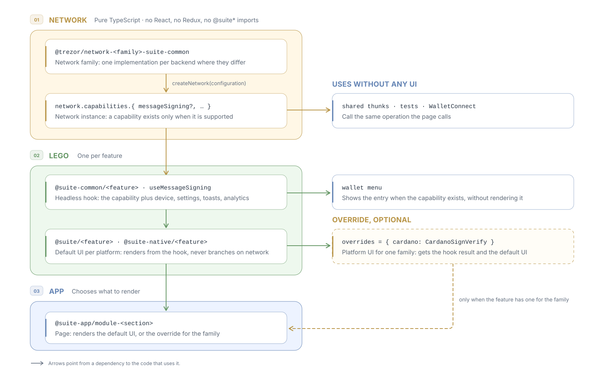

# Networks expose typed capabilities and never render UI

> [!NOTE]
> An alternative to the ADR-003 proposal ([#34612](https://github.com/trezor/trezor-suite/pull/34612))
> for how Suite features reach networks. Supersedes the part of
> [ADR-001](./001-separate-app-and-lego-code.md) that lets network packages import UI. Reference
> implementation: [`develop...b5f7c559e7`][reference].

## Context

ADR-003 settles much of what this ADR builds on: a family's logic stays headless in its
`-suite-common` package, a feature is resolved per account and context, and backends stay inside
the family. The two differ on the boundary. For a feature whose UI differs between networks,
ADR-003 makes a React component the contract. This ADR makes a typed capability the contract and
keeps the UI in the feature.

Two kinds of teams meet at that boundary. The networks team adds networks and keeps them working.
Product teams build features for every network without knowing how each one works. A component as
the boundary costs both of them:

- **Nothing is checked across networks.** The contract is `{ Component }`, so the compiler cannot
  see what a network offers or where families differ. A missing case shows up in review, not as a
  type error.
- **Only UI reaches the logic.** Thunks, WalletConnect and tests have no contract to call. On
  `develop`, WalletConnect's adapters build their own device requests.
- **The boundary is open to interpretation.** ADR-003 is a living document, its main decision is
  "optional, not mandatory", and lego is optional: "A module may use some, all or none of it".
  Each family may keep its own copy of a form and its state for good.
- **Network packages depend on the app.** Today no package under `networks/` depends on React,
  Redux or `@suite*`. ADR-003 adds React layers to every family and lets them import app lego. Its
  first implementation, [#34934](https://github.com/trezor/trezor-suite/pull/34934), loosens
  `forbidden-deps` for that, and keeps the signing logic outside the families because moving it in
  "would create a cycle".

## Decision

Terms follow the ADR-002 proposal ([#34518](https://github.com/trezor/trezor-suite/pull/34518)): a
**Network** is one blockchain network, a **NetworkFamily** a group of networks sharing a protocol
model. A **network instance** is a Network in one runtime configuration.



1. **Network packages are pure TypeScript.** No React, Redux, translation catalogs or `@suite*`
   imports. App data arrives as call parameters.
2. **A family creates a network instance per configuration:** the backend, the account type and
   the version. Pages never pass a backend.
3. **A feature is a typed capability on the instance,** absent when unsupported. One type lists
   every capability, so the compiler checks every family against it.
4. **What differs between families is the family's own type.** Shared code picks from the options
   a family offers; code that narrows a network to its family passes typed values.
5. **UI belongs to the feature:** one headless hook, one default UI per platform with no network
   branches, and a per-family override as the last resort.
6. **The application supplies the rest:** Trezor Connect, the backend choice, translation,
   analytics, notifications and layout. A network never imports a catalog or reports an event.

```ts
// 1. Each family states its own parameters. The shared contract never names them.
type BitcoinSignParams = { format: 'default' | 'electrum' };
type CardanoSignParams = { publicKeyFormat: 'raw' | 'cose' };

// 2. A family's capability is generic over its parameters; the shared contract is not.
type MessageSigning = {
    getChoices(account: OpenAccount): readonly SignChoice[]; // parameters as labelled options
    sign(params: SignParams & { selection?: SignSelection }): Promise<Result<Signed, SignError>>;
    verify?: (params: VerifyParams) => Promise<Result<void, SignError>>; // absent: cannot verify
};
type FamilyMessageSigning<TParams> = MessageSigning & {
    signWithParams(params: SignParams & TParams): Promise<Result<Signed, SignError>>;
};

// 3. A mapped type over TParams makes the family describe every parameter, with options of
//    that parameter's own type. Leaving one out, or offering Bitcoin a 'cose' value, does not
//    compile.
const bitcoinSigning = defineMessageSigning<BitcoinAccount, BitcoinSignParams>({
    params: {
        format: {
            kind: 'signature',
            getOptions: account => (account.isLegacy ? [trezor] : [trezor, electrum]),
        },
    },
    sign: ({ format, ...params }) =>
        trezorConnect.signMessage({ ...params, no_script_type: format === 'electrum' }),
});

// 4. Shared code (forms, thunks, WalletConnect) gets the open contract for any network. It shows
//    the choices and hands back the option ids it was given.
const signing = getNetwork({ symbol, accountType })?.capabilities.messageSigning;
const [choice] = signing?.getChoices(account) ?? [];
signing?.sign({ ...params, selection: { [choice.key]: choice.options[1].id } });
signing?.sign({ ...params, format: 'electrum' }); // ✗ shared code cannot name a family's value

// 5. Code that knows its family narrows the network and gets the family's types back.
if (bitcoinFamily.isOwnNetwork(network)) {
    network.capabilities.messageSigning?.signWithParams({ ...params, format: 'electrum' }); // ✓
    network.capabilities.messageSigning?.signWithParams({ ...params, format: 'cose' }); // ✗
}
```

Each family keeps precise types for its own parameters, and code that narrows to a family gets them
back. Shared code never needs a union of every family's parameters, which is the engine that
ADR-003 rejects: it only passes back what a family offered. Adding a parameter, such as a Cardano
key role, changes that family and nothing else. The names follow the reference implementation,
whose type tests check each ✗ above; the exact API is not part of this decision. There, Sign &
Verify went from 41 network checks to 0, the transaction detail from 28 to 1, and WalletConnect
signs through the same capability.

**Superseded:** in ADR-001, the premise that network modules need reusable UI and practical step 3;
in the ADR-003 proposal, decisions 2 and 5 and its Suite and Suite Native layers. Its Assets,
Connect and Suite Common layers stay.

## Rejected alternatives

- **A component as the contract (ADR-003):** see Context.
- **One injected getter per feature:** the list of features lives in the services bag, not on the
  network.
- **A flags engine:** a capability has no interdependent flags or merged parameter type, the
  default UI is ordinary React, and a family that does not fit overrides it.

## Consequences

- **Easier:** a network that fits adds a family and a registration, with no UI. Every consumer
  calls the same operation. Network behavior is tested without React. `network.capabilities.`
  lists what a network can do.
- **Harder:** a feature's first contract is written from the networks known at the time, and
  changing a required member touches every family, which the compiler lists. The default UI renders
  choices between options; other inputs need an override. There are more concepts to learn.
- **Confirmation:** `forbidden-deps` for `networks/` gains React and Redux patterns, and each
  capability keeps a test that it is present exactly where the old feature flag was.
- **Revisit when** most families override a feature's default.

[reference]: https://github.com/trezor/trezor-suite/compare/develop...b5f7c559e7e851667288f95acd2632381d9443bd
