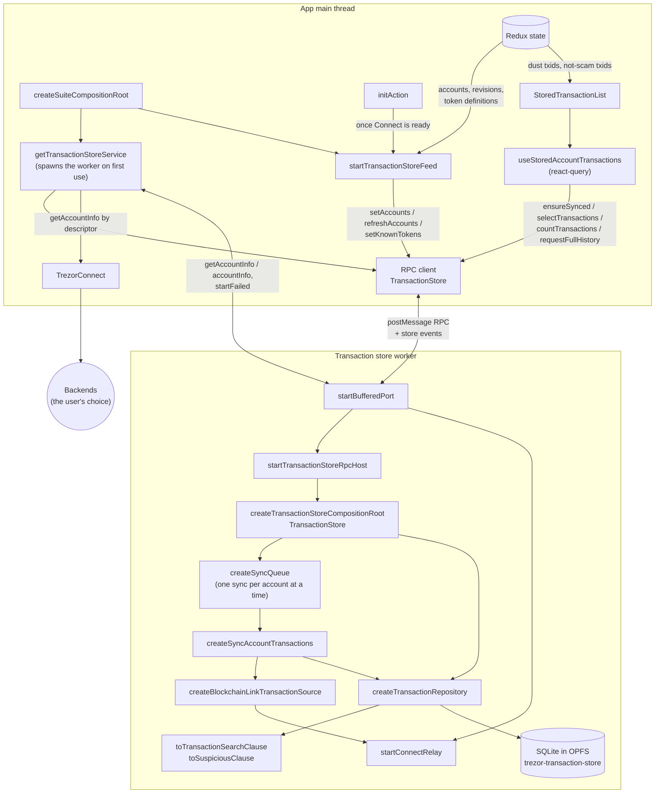
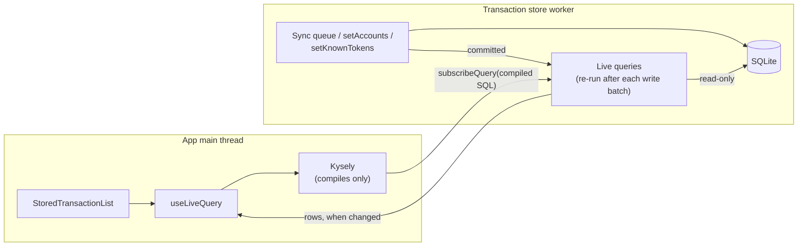
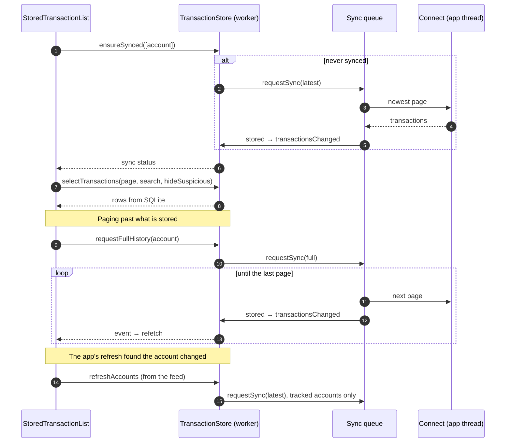
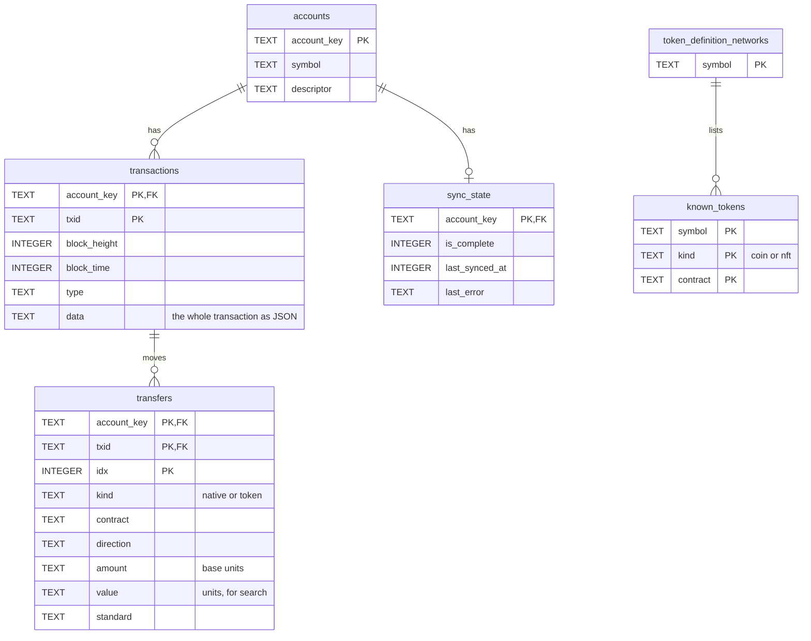

# @suite-common/transaction-store

A local copy of the accounts' transaction history, kept in SQLite, so the app can page, search,
count and filter over everything stored without asking a backend each time.

It is lazy: it downloads an account's history only once something asks for it, keeps those
accounts fresh when the app says they changed, and has no clock of its own.

- `@suite-common/transaction-store` (this package): the engine. Platform-free; it gets its SQLite and
  its source of history injected.
- `@suite/transaction-store`: the web/desktop host. It runs the engine in a worker, feeds it from
  Redux, fetches its history through the app's Connect and exposes it to React.

The store opens no backend connection of its own. Every page of history comes from the app's
Connect, which already holds one connection per network on the user's chosen backend, and which
reaches Electrum through the desktop main process. Asking by descriptor never involves the device.

## Components

| Component                                                          | Package | Role                                                                                                                            |
| ------------------------------------------------------------------ | ------- | ------------------------------------------------------------------------------------------------------------------------------- |
| `createTransactionStoreCompositionRoot`                            | engine  | Migrates the schema and wires the engine into a `TransactionStore`.                                                             |
| `createSyncQueue`                                                  | engine  | Runs one sync per account at a time; a request arriving mid-sync runs once more after it. Reports each account's sync status.   |
| `createSyncAccountTransactions`                                    | engine  | Fetches pages from the source and stores them: the newest page (`latest`) or the whole history (`full`).                        |
| `createTransactionRepository`                                      | engine  | All SQL: accounts, transactions, transfers, sync state and known tokens. Filters by asset, search and suspiciousness.           |
| `toTransactionSearchClause`                                        | engine  | The Redux list's search syntax as SQL.                                                                                          |
| `toSuspiciousClause`                                               | engine  | The app's phishing detectors, except dust, as SQL.                                                                              |
| `createBlockchainLinkTransactionSource`                            | engine  | Reads history pages through a `BlockchainLinkClient`, which on web and desktop is the relay.                                    |
| `createTransactionStoreRpcClient` / `startTransactionStoreRpcHost` | engine  | The typed RPC between the app and the worker.                                                                                   |
| `transactionStoreWorker`                                           | host    | The worker entry. Opens SQLite, starts the engine and serves it.                                                                |
| `startConnectRelay`                                                | host    | Sends each `getAccountInfo` to the app and resolves it with Connect's answer.                                                   |
| `getTransactionStoreService`                                       | host    | Spawns the worker on first use and owns it. Answers the relay with Connect's `getAccountInfo`.                                  |
| `startTransactionStoreFeed`                                        | host    | Pushes what changed in Redux to the store: accounts, account revisions and known tokens. Stops the store when it gets disabled. |
| `useStoredAccountTransactions`                                     | host    | A page, its count and the sync status for React. Refetches on the store's events.                                               |

## Where this is going

Planned next, not built yet: typed queries and live results over the RPC. The app builds queries
with Kysely against the store's table types; the worker runs them read-only and pushes new rows
whenever a write changes a result. That replaces the store events, `selectTransactions`,
`countTransactions`, `getSyncStatus` and react-query. Sync status becomes a column the queue writes.

## Reading a page

## Schema

Removing an account from `setAccounts` deletes its transactions, transfers and sync state through
the cascades.

## Hiding suspicious transactions

The filter runs in SQL, so pages and counts stay right over the whole stored history.

- **In the store:** the detectors that need only the transaction and the network's token
  definitions: zero-value transfers, fake tokens, unknown transactions, TRC-10 transfers and
  unsolicited Stellar offers. The feed keeps `known_tokens` in step with the definitions and the
  user's show/hide choices.
- **From the app:** dust depends on fiat rates, which are dynamic and not stored. The app flags dust
  among the transactions it has in Redux and passes their txids, along with those the user marked
  "not a scam".
