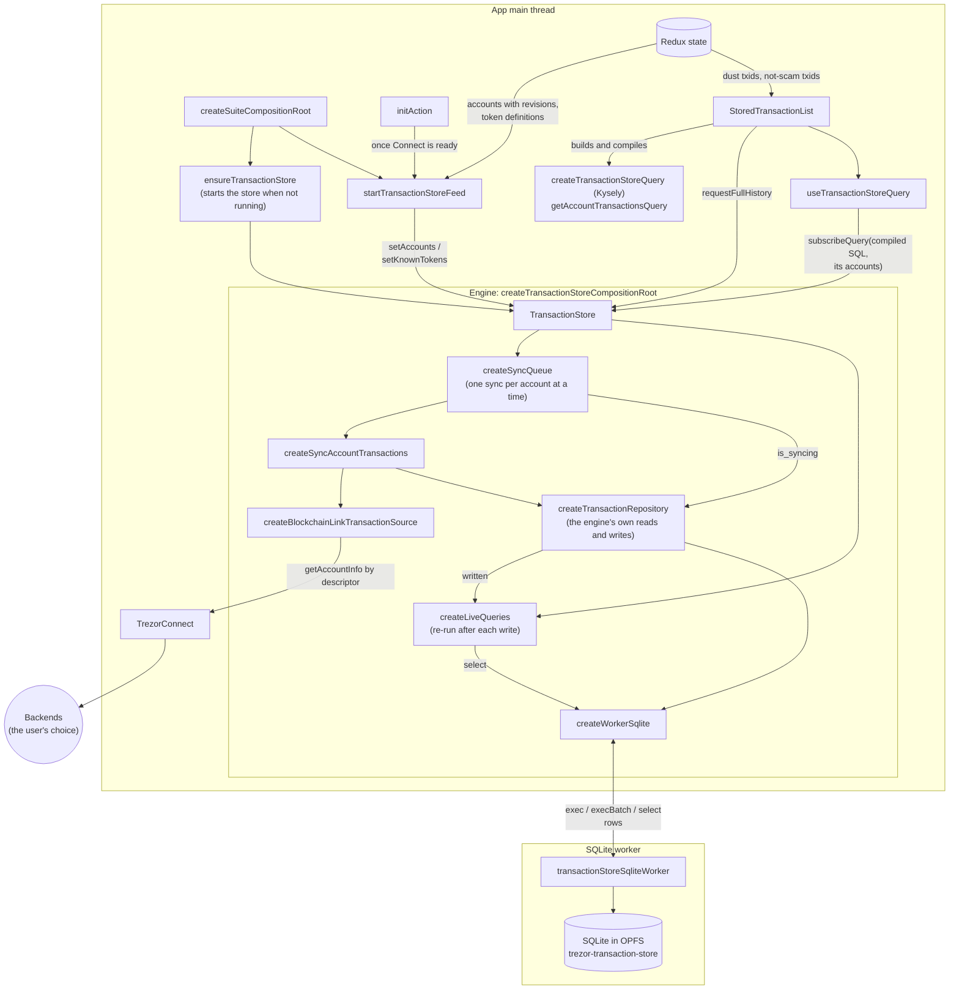
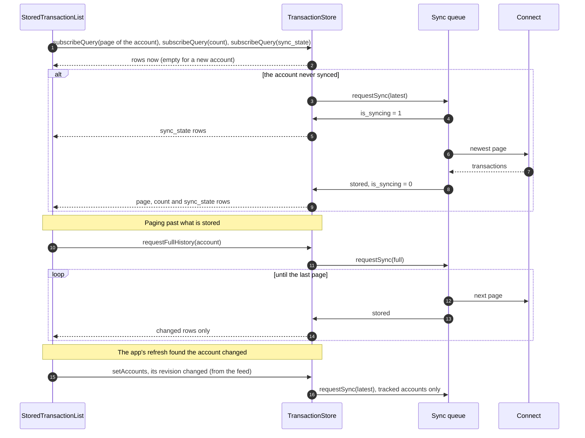
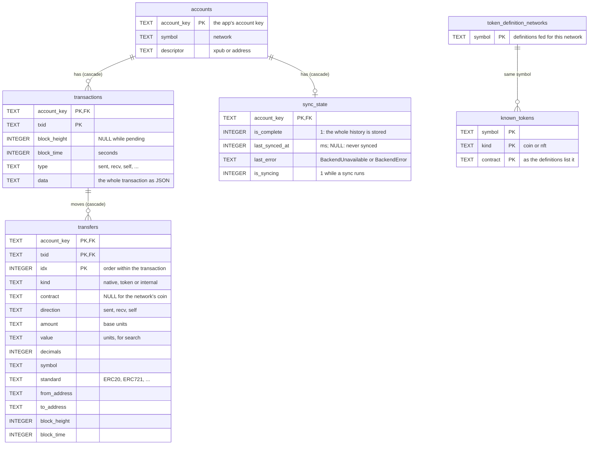

# @suite-common/transaction-store

A local copy of the accounts' transaction history, kept in SQLite, so the app can page, search,
count and filter over everything stored without asking a backend each time.

It is lazy: it downloads an account's history only once something asks for it, keeps those
accounts fresh when the app says they changed, and has no clock of its own.

- `@suite-common/transaction-store` (this package): the engine. Platform-free; it gets its SQLite and
  its source of history injected.
- `@suite/transaction-store`: the web/desktop host. It runs the engine in the app, keeps SQLite in a
  worker, feeds the engine from Redux, fetches history through the app's Connect and exposes it to
  React.

The engine runs where the app does, as Evolu's does; only SQLite runs in a worker, as on web the
OPFS database is reachable only from one. The worker just runs the statements it is sent: one at a
time, a batch atomically, or a query read-only (`PRAGMA query_only`).

The store opens no backend connection of its own. Every page of history comes from the app's
Connect, which already holds one connection per network on the user's chosen backend, and which
reaches Electrum through the desktop main process. Asking by descriptor never involves the device.

The app reads with queries of its own, as with Evolu: `createTransactionStoreQuery` builds one with
Kysely against the store's table types (`TransactionStoreDatabase`) and compiles it, and
`useTransactionStoreQuery` keeps it open, sending new rows whenever a write changes the result. A
query names the accounts it reads; subscribing to it is what downloads their history. The rest of
the API is three commands: `setAccounts` (each with a revision; a changed one re-syncs the
account), `setKnownTokens` and `requestFullHistory`.

## Components

| Component                                                  | Package | Role                                                                                                                               |
| ---------------------------------------------------------- | ------- | ---------------------------------------------------------------------------------------------------------------------------------- |
| `createTransactionStoreQuery` / `TransactionStoreDatabase` | engine  | Builds a query with Kysely over the store's table types and compiles it; the store runs the SQL.                                   |
| `getAccountTransactionsQuery`                              | engine  | An account's transactions, filtered by asset, search and suspiciousness; the caller picks columns, order and page, or counts.      |
| `matchesTransactionSearch`                                 | engine  | The Redux list's search syntax as a Kysely condition.                                                                              |
| `isNotSuspicious`                                          | engine  | The app's phishing detectors, except dust, as a Kysely condition.                                                                  |
| `createTransactionStoreCompositionRoot`                    | engine  | Wires the engine into a `TransactionStore`; migrates the schema, which every call waits for.                                       |
| `createLiveQueries`                                        | engine  | Runs the app's queries read-only and re-runs the open ones after each write, sending only changed results.                         |
| `createSyncQueue`                                          | engine  | Runs one sync per account at a time; a request arriving mid-sync runs once more after it. Marks the account as syncing.            |
| `createSyncAccountTransactions`                            | engine  | Fetches pages from the source and stores them: the newest page (`latest`) or the whole history (`full`).                           |
| `createTransactionRepository`                              | engine  | The engine's own reads and writes, in Kysely. Each write is one atomic batch and tells the live queries.                           |
| `createBlockchainLinkTransactionSource`                    | engine  | Reads history pages through a `BlockchainLinkClient`, which on web and desktop is the app's Connect.                               |
| `ensureTransactionStore`                                   | host    | Starts the store and its SQLite worker when not running, with Connect as the source of history.                                    |
| `createWorkerSqlite` / `transactionStoreSqliteWorker`      | host    | The engine's SQLite: the app side sends statements, the worker runs them on the OPFS database.                                     |
| `startTransactionStoreFeed`                                | host    | Pushes what changed in Redux to the store: accounts with their revisions, and known tokens. Stops the store when it gets disabled. |
| `useTransactionStoreQuery`                                 | host    | Keeps a compiled query open in the store and returns its latest rows, as Evolu's `useQuery`.                                       |

## Reading a page

## Schema

The database `trezor-transaction-store` (OPFS), after the five migrations in
`transactionStoreMigrations.ts`; `TransactionStoreDatabase` types it for Kysely. Removing an account
in `setAccounts` deletes its transactions, transfers and sync state through the cascades; resetting
or wiping the app deletes the whole database.

| Index                  | On                                                   | For                                          |
| ---------------------- | ---------------------------------------------------- | -------------------------------------------- |
| `transactions_by_time` | `transactions (account_key, block_time DESC)`        | an account's history, newest first           |
| `transfers_by_asset`   | `transfers (account_key, contract, block_time DESC)` | an asset's history (a token's or the coin's) |

## Hiding suspicious transactions

The filter runs in SQL, so pages and counts stay right over the whole stored history.

- **In the store:** the detectors that need only the transaction and the network's token
  definitions: zero-value transfers, fake tokens, unknown transactions, TRC-10 transfers and
  unsolicited Stellar offers. The feed keeps `known_tokens` in step with the definitions and the
  user's show/hide choices.
- **From the app:** dust depends on fiat rates, which are dynamic and not stored. The app flags dust
  among the transactions it has in Redux and passes their txids, along with those the user marked
  "not a scam".
